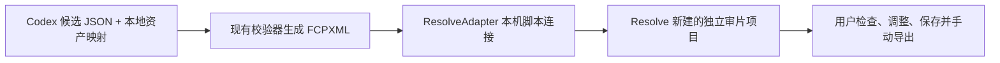

# DaVinci Resolve 脚本 API 接入方案

状态：实现建议；具体兼容性须在目标机器和 Resolve 版本上验证。

## 建议路线

用 Blackmagic 官方 DaVinci Resolve Scripting API 建立本机连接，并调用 `MediaPool.ImportTimelineFromFile()` 把现有校验器生成的 `.fcpxml` 导入一个独立的 Resolve 项目。这样调用方获得原生、可编辑的 Resolve 时间线，同时沿用 `tools/kpl_timeline.py` 已实现的源文件哈希、时间范围、音视频规格、片段重叠和 2～5 分钟校验；不用再维护第二套片段排布逻辑。



FCPXML 在这里仍是可审计、可回退的时间线交换文件；新增的 Resolve 接入会通过官方脚本模块直接触发导入，不需要用户手动选文件。若脚本连接暂不可用，保留原来的手动 FCPXML 导入作为回退路径。

## 版本与本机依赖

- 按 DaVinci Resolve Studio 的外部脚本能力设计。Blackmagic 官方答复说明，同机终端/IDE 外部脚本属于 Studio 功能，并建议按随 Resolve 提供的 Scripting README 配置模块路径。[Blackmagic Design 官方论坛答复](https://forum.blackmagicdesign.com/viewtopic.php?f=21&t=205175)
- 实现时从用户选择的 Resolve 安装目录读取 `DaVinciResolveScript`、`fusionscript.dll` 和官方 Scripting README；不要把某台电脑的安装路径写入项目配置或日志。SDK 与 Resolve 版本应配套，API 返回结果以目标版本实际测试为准。
- 官方接口包括 `GetVersionString()`、`GetCurrentProject()` 和 `MediaPool.ImportTimelineFromFile(filePath, importOptions)`。导入函数支持 FCPXML，`importOptions` 可指定时间线名及素材导入方式。
- 当前项目已有候选/资产校验与 FCPXML 生成器；尚无 Resolve 接入模块或桌面应用。

## 模块接口与实现

在 `tools/` 下新增一个深模块 `ResolveAdapter`，由它封装本机 Python 模块加载、连接诊断、项目隔离、时间线导入与导入结果核验。选片流程只需调用小接口，不直接操作 Resolve 对象：

```python
inspect_connection() -> ResolveStatus
import_review_timeline(
    *, fcpxml_path, project_name, timeline_name
) -> TimelineImportResult
```

`ResolveStatus` 返回已连接状态、程序版本、产品信息、当前数据库/项目及可操作原因。`TimelineImportResult` 返回目标项目和时间线名称、导入时间、素材/片段计数、规格与警告。实现通过官方 `DaVinciResolveScript` 模块访问 `resolve.GetProjectManager()`、`project.GetMediaPool()`，再用 `ImportTimelineFromFile()` 导入已有 XML。

保持连接依赖可替换：生产适配器使用本机 Resolve SDK；自动化测试使用内存假适配器。环境变量仅设置在该次子进程中，不修改系统级 Python、全局 PATH 或用户环境，不安装第三方 Resolve 包。

## 安全与项目隔离

- Studio 偏好设置中的 `External Scripting Using` 只设为 `Local`，不启用 `Network`；如当前不是 Local，由用户在 Resolve 偏好设置中确认后再做连接测试。
- 绝不把时间线导入当前任意工作项目。先核对当前项目；目标不是明确的新建“剪辑助手审片”项目时就中止。导入失败时不自动删除时间线或项目，避免误删用户内容。
- 每次导入使用唯一的项目/时间线名；素材路径仍由资产映射提供，导入前继续校验 SHA-256、时长和剪辑范围。
- 首次真实验收只自动创建时间线，不自动开始渲染。用户确认剪辑后自行调整、保存并导出；渲染队列控制放到后续阶段。
- 在人工基线保存之前，不对 JDG–EDG.M 比赛录像做抽帧、转写或 Codex 分析。API 连通性和时间线导入可先用合成媒体测试。

## 分阶段验收

1. **确认目标安装。** 核实当前 Studio 版本、用户选择的安装，以及本机 SDK 与 `fusionscript.dll` 配对。
2. **只读连接冒烟。** Resolve 已由用户打开且 Studio 的外部脚本设为 Local 后，读取产品/版本、项目管理器和当前项目，不创建或保存项目。若连接返回 `None`，报告缺少 Studio/偏好设置/解释器或 SDK 路径等诊断，不继续写操作。
3. **合成媒体导入测试。** 用临时短视频和音频、全新隔离项目生成测试 FCPXML，再由官方脚本 API 导入；检查时间线对象、片段数、媒体在线、视频规格、声轨、持续时间和可保存/重开。不得使用首测 KPL 录像作此步骤。
4. **首测真实接入。** 用户确认人工基线后，运行既定的本地抽帧/ASR、Codex 候选和全组选择；经校验生成唯一 FCPXML，再通过 ResolveAdapter 导入独立项目。记录调用耗时和返回结果，用户集中审片并自行修改、导出。
5. **可选渲染队列。** 时间线创建稳定后，才评估 `SetRenderSettings()`、`AddRenderJob()`、`GetRenderJobStatus()`。需要用户另行确认目标编码、输出目录和是否允许自动启动渲染。

## 首轮验收条件

- 使用本机官方脚本模块连接到用户指定的 Studio 实例，报告版本和连接状态；不使用网络开放模式。
- 只在独立项目中创建一条与 FCPXML 一致的可编辑时间线；源媒体在线，片段次序、时长、源媒体规格和原音轨与生成文件一致。
- Resolve 重开后项目与时间线仍可用；用户可以修改并手动导出可播放成片。
- 保留人工基线与助手流程的用户投入时间、机器等待、关键事件漏选、待审项和修改量记录；API 接入成功本身不代替剪辑质量验收。

## 未选的实现方式

也可以直接调用 `CreateTimelineFromClips()` / `AppendToTimeline()` 逐段构建原生时间线。该路线要重复实现片段映射、帧取整、源音频和时间线顺序的逻辑，容易与现有 FCPXML 生成器分叉。首轮先用 `ImportTimelineFromFile()` 接起现有产物；若实测不能保留必须的审片备注或轨道语义，再评估逐段 API。
